# App Perpustakaan

Aplikasi manajemen perpustakaan berbasis web yang dibangun menggunakan framework **Laravel 12**.

## Tujuan

Project ini dikembangkan untuk memenuhi tugas praktikum pemgrograman web guna mempelajari dasar konfigurasi environment, manajemen database MySQL, struktur MVC, serta kontrol versi menggunakan Git & GitHub.

## Cara Menjalankan Project secara Lokal

1. Clone repository ini atau simpan di direktori `htdocs` XAMPP.
2. Pastikan service **Apache** dan **MySQL** aktif di XAMPP Control Panel.
3. Salin file `.env.example` menjadi `.env` lalu sesuaikan konfigurasi database (`DB_DATABASE=db_perpustakaan`).
4. Buka terminal di folder project, lalu jalankan perintah berikut:
    ```bash
    composer install
    php artisan key:generate
    php artisan migrate
    php artisan serve
    ```

---

### Tugas 1: Tambahkan Penjelasan MVC (Model, View, Controller)

Tugas ini meminta kamu menuliskan penjelasan singkat (2-3 kalimat) mengenai perbedaan Model, View, dan Controller. Kamu bisa menambahkannya di bagian bawah file `README.md` yang baru saja diedit tadi.

```markdown
## Konsep MVC (Model, View, Controller)

- **Model:** Berfungsi untuk mengelola logika data, aturan bisnis, serta berkomunikasi langsung dengan database.
- **View:** Berfungsi sebagai antarmuka atau tampilan visual yang dilihat langsung oleh pengguna di browser.
- **Controller:** Berfungsi sebagai penghubung (jembatan) antara Model dan View untuk memproses permintaan pengguna.
```

---

### Tugas Minggu 2 :

Dokumentasi untuk hasil screenshoot sebelum admin group dan selesai admin group

#### Sebelum

![Route List Sebelum diubah]


#### Sesudah

![Route List Admin]


---

### Tugas Minggu 3 :

-Link commit GitHub (branch dev) yang berisi hasil tugas

-Screenshot form /members/create setelah submit kosong (menampilkan error validasi) dan setelah submit valid (menampilkan flash message sukses

#### Screenshot form /member/create error kosong

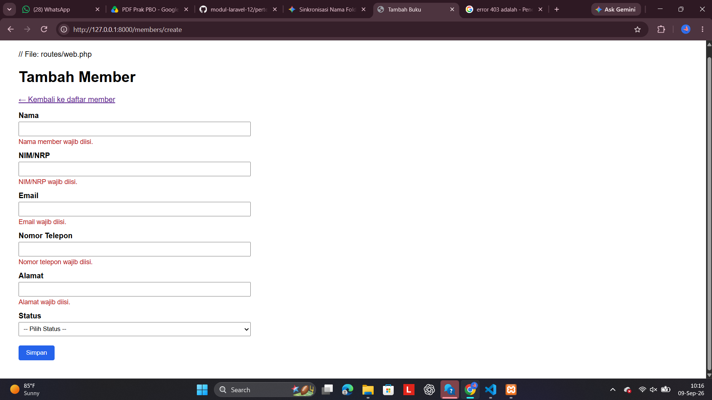

---

### Tugas Minggu 4 :

-Link commit GitHub (branch dev) yang berisi hasil tugas
-Screenshot /books/create dan /categories/create setelah di-refactor, menampilkan navbar yang sama seperti halaman index

#### Screenshot /books/create

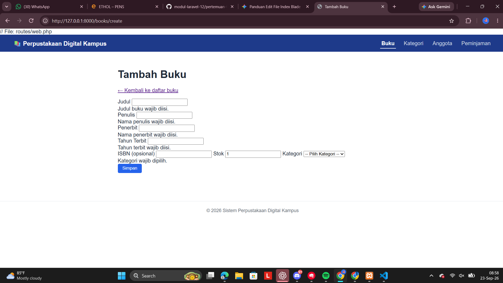

#### Screenshot /categories/create

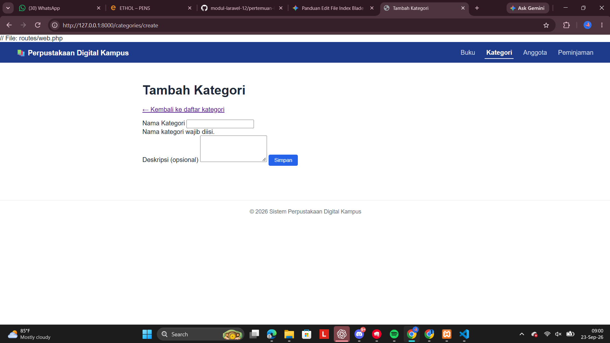

---

### Tugas Minggu 5

-Link commit GitHub (branch dev) yang berisi hasil tugas
-Screenshot /members menampilkan data nyata dari database beserta hasil pencarian nama anggota

#### Screenshot database halaman anggota

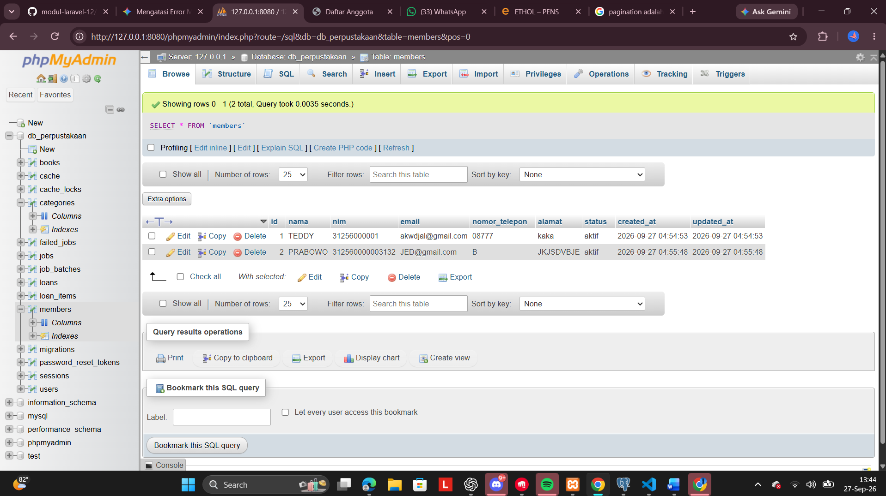
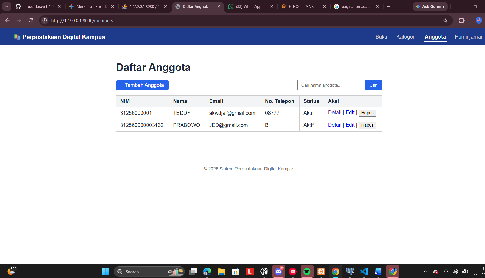

#### Screenshot filtering / hasil pencarian anggota / search

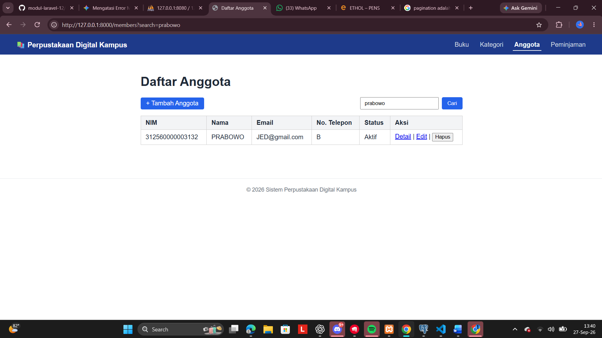

---

### Minggu 6 (Modul 7)

---

#### Screenshot langkah 2

---

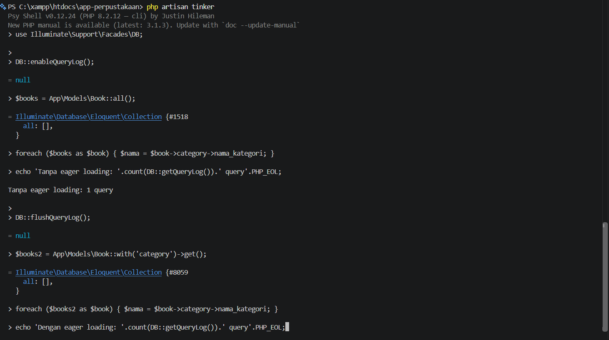

---

#### Screenshot tugas

- Link commit GitHub (branch dev) yang berisi hasil tugas
- Screenshot /loans menampilkan badge status berwarna dan tombol "Kembalikan" yang berfungsi

---

###### Tampilan awal

---

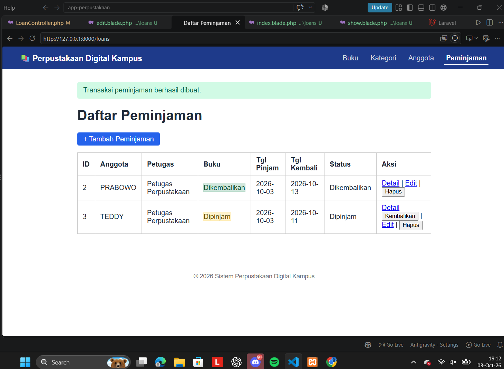

---

###### Button Kembalikan

---

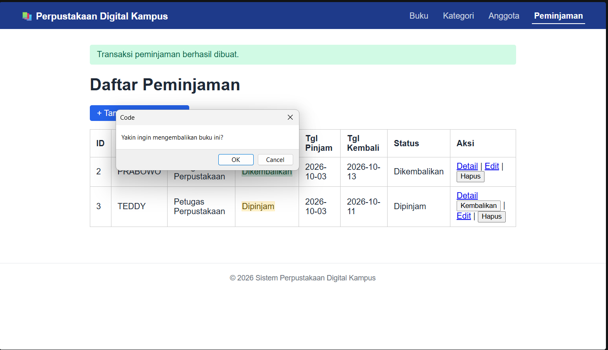

---

###### Tampilan akhir (berhasil dikembalikan )

---

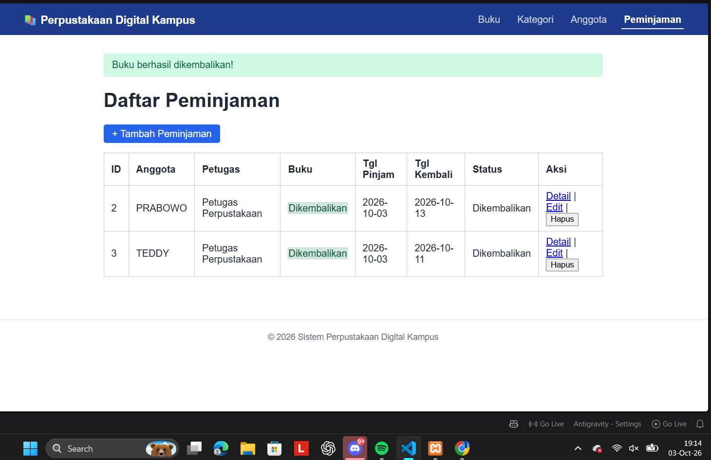

---

### Minggu 7 (Pertemuan 8.md)

---

#### Tugas

---

Lengkapi dua fitur berikut di atas sistem autentikasi yang sudah berfungsi:

1. Halaman profil petugas - buat route GET /profil (terproteksi auth) dan ProfileController@show yang menampilkan nama, email, dan role user yang sedang login lewat auth()->user(). Tambahkan link "Profil" di navbar.
2. Fitur ganti password - tambahkan form di halaman profil dengan tiga input: password lama, password baru, dan konfirmasi password baru. Validasi lengkap: password lama harus cocok dengan yang tersimpan (gunakan Hash::check()), password baru wajib minimal 8 karakter dan harus sama dengan konfirmasinya (confirmed rule). Simpan password baru dengan Hash::make(), jangan pernah simpan sebagai teks biasa.

---

##### Yang dikumpulkan:

1. Link commit GitHub (branch dev) yang berisi hasil tugas
2. Screenshot halaman profil dan proses ganti password yang berhasil (disertai pesan sukses)

---

#### Screenshot tugas

---

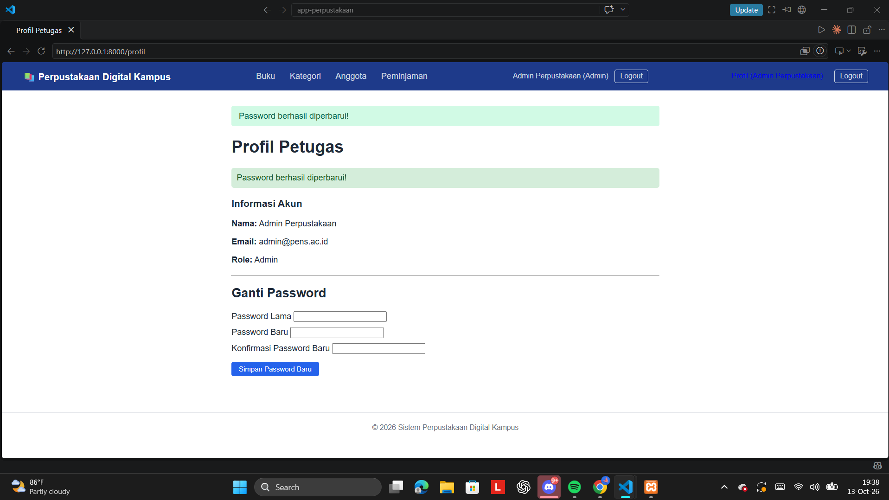

---

### MINGGU 9

#### Dokumentasi REST API - Aplikasi Perpustakaan

Seluruh rute API memerlukan header request berikut:
`Accept: application/json`

| Method | URL                       | Status Code              | Body (jika ada)                                                                                                                                          | Contoh Response                                                                                                                                                                                                                                                                                                                                                                                                                                                                                                                                                                                                                                                                                                                                                                                                                                         |
| ------ | ------------------------- | ------------------------ | -------------------------------------------------------------------------------------------------------------------------------------------------------- | ------------------------------------------------------------------------------------------------------------------------------------------------------------------------------------------------------------------------------------------------------------------------------------------------------------------------------------------------------------------------------------------------------------------------------------------------------------------------------------------------------------------------------------------------------------------------------------------------------------------------------------------------------------------------------------------------------------------------------------------------------------------------------------------------------------------------------------------------------- |
| GET    | `/api/books`              | 200 OK                   | -                                                                                                                                                        | `{"data":[{"id":3,"judul":"KISAH CINTA PRABOWO TEDDY","penulis":"PRABOWO SUBIANTO","penerbit":"GERINDRA BERSAMA PRABOWO TEDDY","tahun_terbit":"2024","isbn":"213616532","stok":257000000,"sampul":null,"category":{"id":15,"nama_kategori":"CERTIA ASLI PRABOWO"},"created_at":"2026-10-03T11:15:11.000000Z","updated_at":"2026-10-03T11:15:11.000000Z"}],"links":{"first":"http://127.0.0.1:8000/api/books?page=1","last":"http://127.0.0.1:8000/api/books?page=1","prev":null,"next":null},"meta":{"current_page":1,"from":1,"last_page":1,"links":[{"url":null,"label":"&laquo; Previous","page":null,"active":false},{"url":"http://127.0.0.1:8000/api/books?page=1","label":"1","page":1,"active":true},{"url":null,"label":"Next &raquo;","page":null,"active":false}],"path":"http://127.0.0.1:8000/api/books","per_page":10,"to":1,"total":1}}` |
| GET    | `/api/books?judul=laskar` | 200 OK                   | -                                                                                                                                                        | `{"data":[{"id":5,"judul":"Laskar Pelangi","penulis":"Andrea Hirata","penerbit":"Bentang Pustaka","tahun_terbit":2005,"isbn":"9789793062792","stok":10,"sampul":null,"category":{"id":15,"nama_kategori":"CERTIA ASLI PRABOWO"}}],"links":{...},"meta":{...}}`                                                                                                                                                                                                                                                                                                                                                                                                                                                                                                                                                                                          |
| GET    | `/api/books/3`            | 200 OK                   | -                                                                                                                                                        | `{"data":{"id":3,"judul":"KISAH CINTA PRABOWO TEDDY","penulis":"PRABOWO SUBIANTO","penerbit":"GERINDRA BERSAMA PRABOWO TEDDY","tahun_terbit":"2024","isbn":"213616532","stok":257000000,"sampul":null,"category":{"id":15,"nama_kategori":"CERTIA ASLI PRABOWO"}}}`                                                                                                                                                                                                                                                                                                                                                                                                                                                                                                                                                                                     |
| GET    | `/api/books/999`          | 404 Not Found            | -                                                                                                                                                        | `{"message":"No query results for model [App\\Models\\Book] 999"}`                                                                                                                                                                                                                                                                                                                                                                                                                                                                                                                                                                                                                                                                                                                                                                                      |
| POST   | `/api/books`              | 201 Created              | `{"judul":"Buku Contoh","penulis":"Penulis Contoh","penerbit":"Penerbit Contoh","tahun_terbit":2024,"stok":10,"category_id":15}`                         | `{"data":{"id":6,"judul":"Buku Contoh","penulis":"Penulis Contoh","penerbit":"Penerbit Contoh","tahun_terbit":2024,"isbn":null,"stok":10,"sampul":null,"category":{"id":15,"nama_kategori":"CERTIA ASLI PRABOWO"}}}`                                                                                                                                                                                                                                                                                                                                                                                                                                                                                                                                                                                                                                    |
| POST   | `/api/books`              | 422 Unprocessable Entity | `{}`                                                                                                                                                     | `{"message":"Kategori yang dipilih tidak valid. (and 5 more errors)","errors":{"judul":["The judul field is required."],"penulis":["The penulis field is required."],"category_id":["Kategori yang dipilih tidak valid."]}}`                                                                                                                                                                                                                                                                                                                                                                                                                                                                                                                                                                                                                            |
| PUT    | `/api/books/3`            | 200 OK                   | `{"judul":"KISAH CINTA PRABOWO TEDDY (REVISI)","penulis":"PRABOWO SUBIANTO","penerbit":"GERINDRA PRESS","tahun_terbit":2024,"stok":10,"category_id":15}` | `{"data":{"id":3,"judul":"KISAH CINTA PRABOWO TEDDY (REVISI)","penulis":"PRABOWO SUBIANTO","penerbit":"GERINDRA PRESS","tahun_terbit":2024,"isbn":"213616532","stok":10,"sampul":null,"category":{"id":15,"nama_kategori":"CERTIA ASLI PRABOWO"}}}`                                                                                                                                                                                                                                                                                                                                                                                                                                                                                                                                                                                                     |
| DELETE | `/api/books/6`            | 200 OK                   | -                                                                                                                                                        | `{"message":"Buku berhasil dihapus."}`                                                                                                                                                                                                                                                                                                                                                                                                                                                                                                                                                                                                                                                                                                                                                                                                                  |
| GET    | `/api/members`            | 200 OK                   | -                                                                                                                                                        | `{"data":[{"id":1,"nama":"TEDDY","nim":"3125600001","email":"teddy@gmail.com","nomor_telepon":"08123456789","alamat":"Surabaya","status":"aktif"}],"links":{...},"meta":{...}}`                                                                                                                                                                                                                                                                                                                                                                                                                                                                                                                                                                                                                                                                         |
| GET    | `/api/members/1`          | 200 OK                   | -                                                                                                                                                        | `{"data":{"id":1,"nama":"TEDDY","nim":"3125600001","email":"teddy@gmail.com","nomor_telepon":"08123456789","alamat":"Surabaya","status":"aktif"}}`                                                                                                                                                                                                                                                                                                                                                                                                                                                                                                                                                                                                                                                                                                      |
| GET    | `/api/loans`              | 200 OK                   | -                                                                                                                                                        | `{"data":[{"id":4,"member":{"id":1,"nama":"TEDDY"},"petugas":{"id":3,"name":"Petugas Satu"},"tanggal_pinjam":"2026-10-07","tanggal_kembali":"2026-10-14","tanggal_dikembalikan":null,"status":"dipinjam","books":[{"id":3,"judul":"KISAH CINTA PRABOWO TEDDY"}]}],"links":{...},"meta":{...}}`                                                                                                                                                                                                                                                                                                                                                                                                                                                                                                                                                          |
| POST   | `/api/loans`              | 201 Created              | `{"member_id":1,"user_id":3,"tanggal_pinjam":"2026-11-04","tanggal_kembali":"2026-11-11","book_ids":[3]}`                                                | `{"data":{"id":5,"member":{"id":1,"nama":"TEDDY"},"petugas":{"id":3,"name":"Petugas Satu"},"tanggal_pinjam":"2026-11-04","tanggal_kembali":"2026-11-11","tanggal_dikembalikan":null,"status":"dipinjam","books":[{"id":3,"judul":"KISAH CINTA PRABOWO TEDDY"}]}}`                                                                                                                                                                                                                                                                                                                                                                                                                                                                                                                                                                                       |
| PUT    | `/api/loans/4/kembalikan` | 200 OK                   | -                                                                                                                                                        | `{"data":{"id":4,"member":{"id":1,"nama":"TEDDY"},"petugas":{"id":3,"name":"Petugas Satu"},"tanggal_pinjam":"2026-10-07","tanggal_kembali":"2026-10-14","tanggal_dikembalikan":"2026-11-04","status":"dikembalikan","books":[{"id":3,"judul":"KISAH CINTA PRABOWO TEDDY"}]}}`                                                                                                                                                                                                                                                                                                                                                                                                                                                                                                                                                                           |
| GET    | `/api/stats`              | 200 OK                   | -                                                                                                                                                        | `{"total_buku":10,"total_anggota":5,"peminjaman_aktif":1}`                                                                                                                                                                                                                                                                                                                                                                                                                                                                                                                                                                                                                                                                                                                                                                                              |
