# App Perpustakaan

Aplikasi manajemen perpustakaan berbasis web yang dibangun menggunakan framework **Laravel 12**.

## Tujuan

Project ini dikembangkan untuk memenuhi tugas praktikum pemgrograman web guna mempelajari dasar konfigurasi environment, manajemen database MySQL, struktur MVC, serta kontrol versi menggunakan Git & GitHub.

## Cara Menjalankan Project secara Lokal

1. Clone repository ini atau simpan di direktori `htdocs` XAMPP.
2. Pastikan service **Apache** dan **MySQL** aktif di XAMPP Control Panel.
3. Salin file `.env.example` menjadi `.env` lalu sesuaikan konfigurasi database (`DB_DATABASE=db_perpustakaan`).
4. Buka terminal di folder project, lalu jalankan perintah berikut:
    ```bash
    composer install
    php artisan key:generate
    php artisan migrate
    php artisan serve
    ```

---

### Tugas 1: Tambahkan Penjelasan MVC (Model, View, Controller)

Tugas ini meminta kamu menuliskan penjelasan singkat (2-3 kalimat) mengenai perbedaan Model, View, dan Controller. Kamu bisa menambahkannya di bagian bawah file `README.md` yang baru saja diedit tadi.

```markdown
## Konsep MVC (Model, View, Controller)

- **Model:** Berfungsi untuk mengelola logika data, aturan bisnis, serta berkomunikasi langsung dengan database.
- **View:** Berfungsi sebagai antarmuka atau tampilan visual yang dilihat langsung oleh pengguna di browser.
- **Controller:** Berfungsi sebagai penghubung (jembatan) antara Model dan View untuk memproses permintaan pengguna.
```

---

### Tugas Minggu 2 :

Dokumentasi untuk hasil screenshoot sebelum admin group dan selesai admin group

#### Sebelum

![Route List Sebelum diubah]


#### Sesudah

![Route List Admin]


---

### Tugas Minggu 3 :

-Link commit GitHub (branch dev) yang berisi hasil tugas

-Screenshot form /members/create setelah submit kosong (menampilkan error validasi) dan setelah submit valid (menampilkan flash message sukses

#### Screenshot form /member/create error kosong

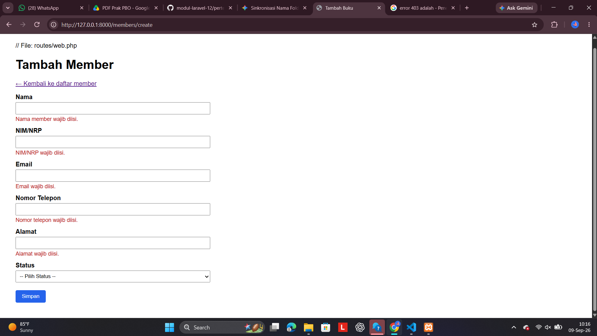

---

### Tugas Minggu 4 :

-Link commit GitHub (branch dev) yang berisi hasil tugas
-Screenshot /books/create dan /categories/create setelah di-refactor, menampilkan navbar yang sama seperti halaman index

#### Screenshot /books/create

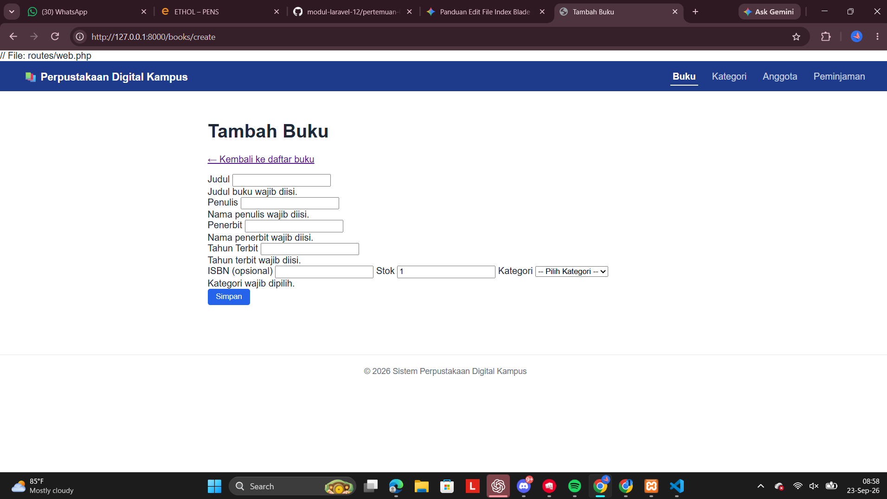

#### Screenshot /categories/create

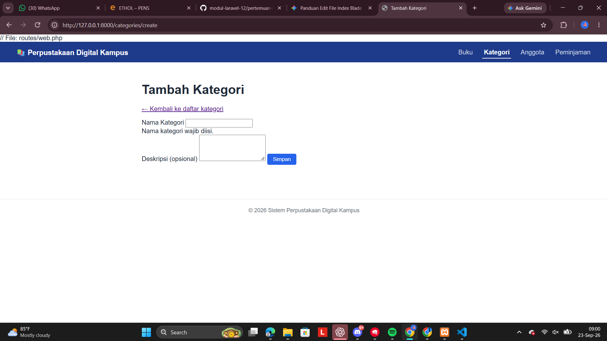

---

### Tugas Minggu 5

-Link commit GitHub (branch dev) yang berisi hasil tugas
-Screenshot /members menampilkan data nyata dari database beserta hasil pencarian nama anggota

#### Screenshot database halaman anggota

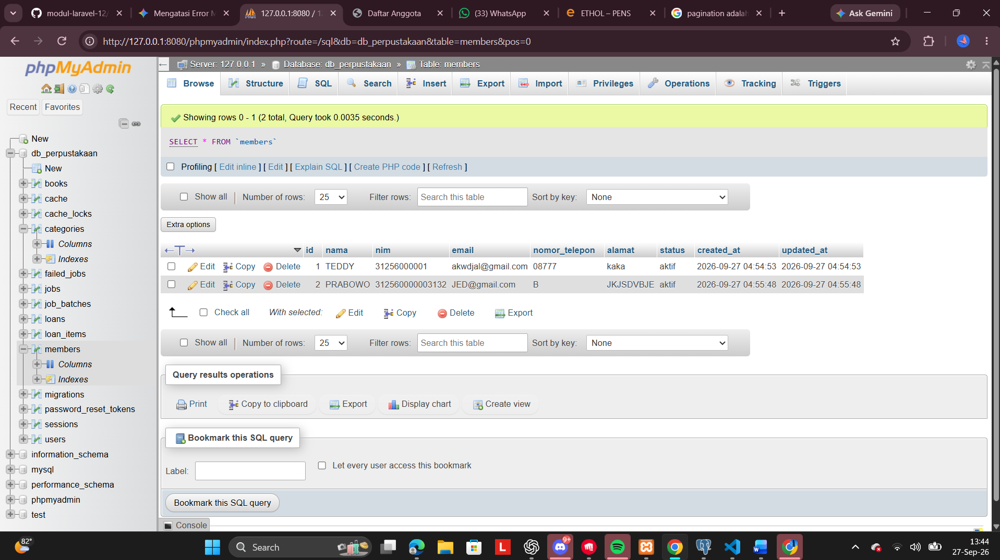
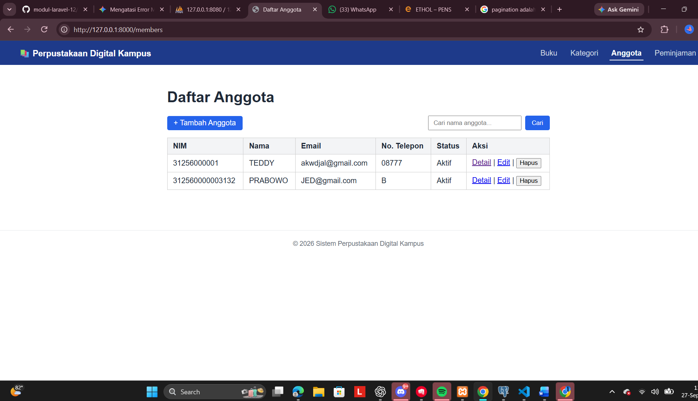

#### Screenshot filtering / hasil pencarian anggota / search

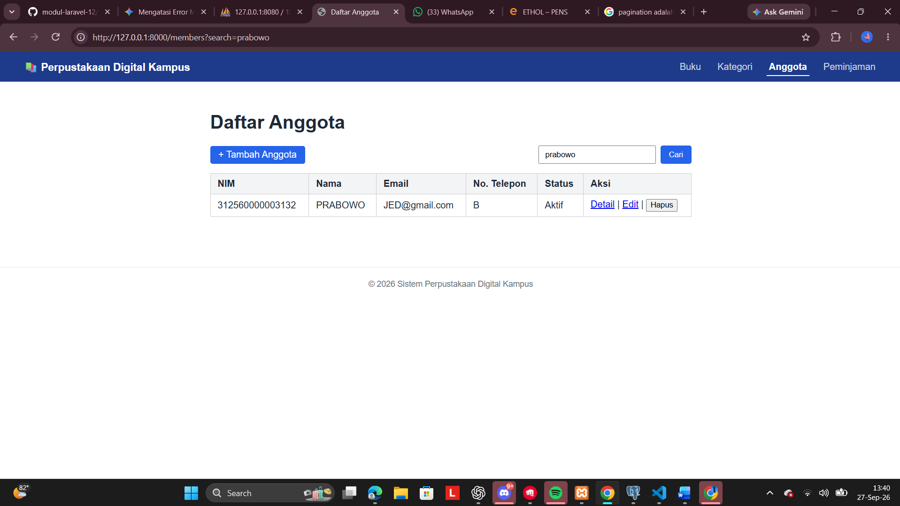

---

### Minggu 6 (Modul 7)

---

#### Screenshot langkah 2

---

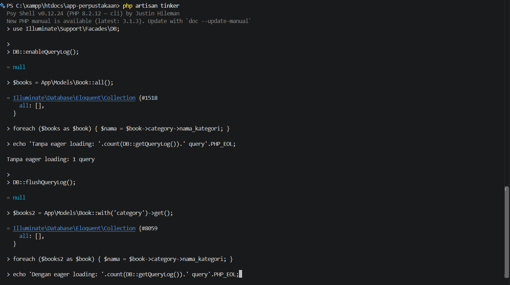

---

#### Screenshot tugas

- Link commit GitHub (branch dev) yang berisi hasil tugas
- Screenshot /loans menampilkan badge status berwarna dan tombol "Kembalikan" yang berfungsi

---

###### Tampilan awal

---

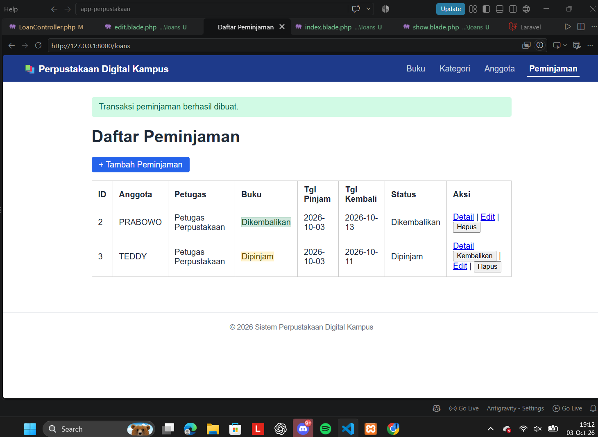

---

###### Button Kembalikan

---

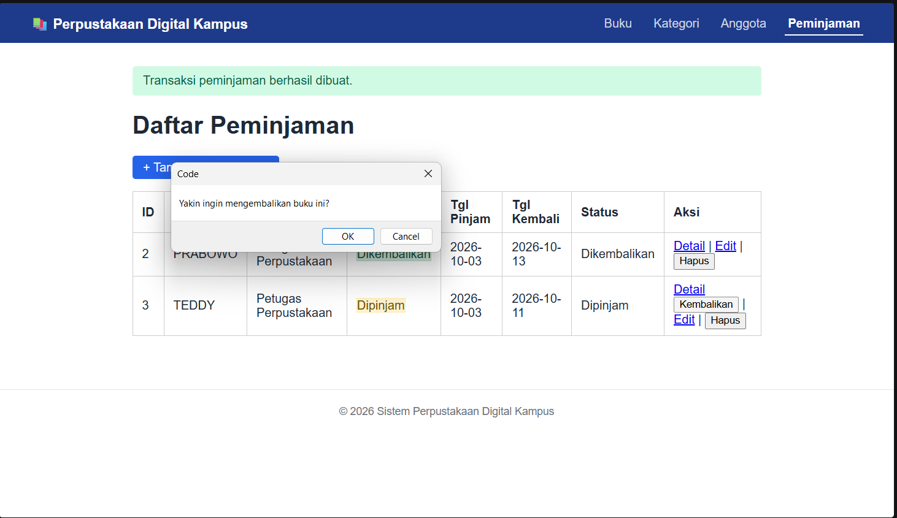

---

###### Tampilan akhir (berhasil dikembalikan )

---

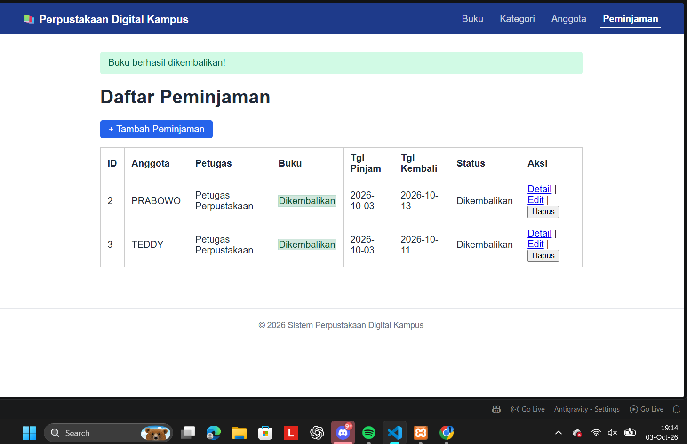

---

### Minggu 7 (Pertemuan 8.md)

---

#### Tugas

---

Lengkapi dua fitur berikut di atas sistem autentikasi yang sudah berfungsi:

1. Halaman profil petugas - buat route GET /profil (terproteksi auth) dan ProfileController@show yang menampilkan nama, email, dan role user yang sedang login lewat auth()->user(). Tambahkan link "Profil" di navbar.
2. Fitur ganti password - tambahkan form di halaman profil dengan tiga input: password lama, password baru, dan konfirmasi password baru. Validasi lengkap: password lama harus cocok dengan yang tersimpan (gunakan Hash::check()), password baru wajib minimal 8 karakter dan harus sama dengan konfirmasinya (confirmed rule). Simpan password baru dengan Hash::make(), jangan pernah simpan sebagai teks biasa.

---

##### Yang dikumpulkan:

1. Link commit GitHub (branch dev) yang berisi hasil tugas
2. Screenshot halaman profil dan proses ganti password yang berhasil (disertai pesan sukses)

---

#### Screenshot tugas

---

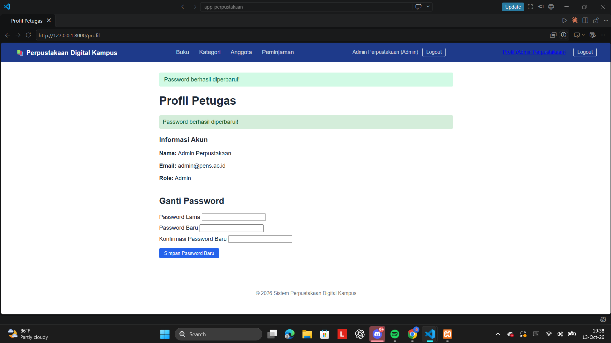

---
